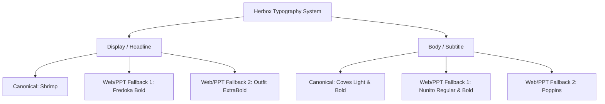

# Herbox Design System Specification (v1.0.0)

Dokumen ini adalah spesifikasi arsitektur desain komprehensif untuk **Herbox (Herbivore's Box)**. Didesain modular agar reusable untuk:
1. **Slide Presentation (PowerPoint, Keynote, Google Slides)**
2. **Digital Products (Web, Mobile App, Webview)**
3. **Marketing & Social Media (Instagram, TikTok, Packaging)**

---

## 1. Filosofi & Karakter Brand

Herbox adalah konsep makanan bento/rice box berbasis nabati (vegetarian/vegan-friendly) dengan misi:
> *"Menghadirkan makanan sehat yang lezat, fun, dan terjangkau bagi siapa saja."*

### 3 Nilai Inti Visual
* **Approachable (Ramah & Inklusif):** Sudut membulat (*rounded corners*), warna hangat natural (*warm ivory*), tidak kaku, dan bebas intimidasi gaya hidup sehat yang mahal.
* **Fun (Menyenangkan & Ceria):** Tipografi gemuk bersahabat, kontras warna berani (*coral red* bertemu *forest green*), dan ilustrasi bentuk organik (*supergraphics*).
* **Fresh (Segar & Berenergi):** Hijau botani yang membangkitkan kesegaran sayuran panen baru, dipadu dengan aksen merah yang memicu nafsu makan (*appetite appeal*).

---

## 2. Logo Guidelines & Clear Space

### A. Format Logo
* **Wordmark:** Logotype tipografi bersahabat *"Herbox"*.
* **Varian Resmi:**
  * `Herbox Logo-red.png` — Logo utama pada background terang (Ivory `#F7F4E2` atau White `#FFFFFF`).
  * `Herbox Logo-offwhite.png` — Logo pada background gelap (Forest Green `#265A32` atau Dark Charcoal).
  * `Herbox Logo-green.png` — Varian alternatif pada background terang.
  * `Herbox Logo-black.png` — Varian monokrom (surat kabar, fax, stempel).

### B. Clear Space Rule
* **Zona Eksklusi `2x`:** Di sekeliling logo harus terdapat ruang kosong minimal selebar `2x` (di mana `x` adalah ketebalan batang huruf logo Herbox). Dilarang menempatkan teks, ikon, atau batas tepi frame di dalam zona ini.

### C. Larangan Keras (Strict Don'ts)
* ❌ DILARANG mendistorsi proporsi (stretch horizontal/vertikal).
* ❌ DILARANG memutar atau memiringkan sudut logo (*no rotation*).
* ❌ DILARANG menambahkan drop shadow, bevel, gradient, atau stroke efek.
* ❌ DILARANG menaruh logo di atas foto makanan yang ramai tanpa overlay atau bento badge.

---

## 3. Design Tokens: Color System

Herbox menggunakan sistem token 3 tingkat: **Global Primitive**, **Semantic Role**, dan **F&B Accent**.

### A. Primitive Tokens (Palette)
| Token Name | Hex Code | RGB | HSL | CMYK (GSM) | Karakter |
| :--- | :--- | :--- | :--- | :--- | :--- |
| `color.brand.coral-red` | `#ED5855` | `237, 88, 85` | `1° 80% 63%` | `1, 13, 99, 0` | Energetik, lapar, aksi CTA |
| `color.brand.forest-green` | `#265A32` | `38, 90, 50` | `134° 41% 25%` | `58, 0, 44, 65` | Alami, nabati, grounding |
| `color.brand.ivory-base` | `#F7F4E2` | `247, 244, 226` | `51° 54% 93%` | `4, 2, 2, 0` | Hangat, kanvas packaging, ramah mata |
| `color.brand.leaf-sage` | `#9EBF81` | `158, 191, 129` | `92° 33% 63%` | `17, 0, 32, 25` | Aksen sekunder, badge sehat |
| `color.brand.terracotta` | `#E17A65` | `225, 122, 101` | `10° 68% 64%` | `0, 46, 55, 12` | Aksen hangat, supergraphic |
| `color.neutral.charcoal` | `#1C1C1C` | `28, 28, 28` | `0° 0% 11%` | `0, 0, 0, 95` | Teks utama readability tinggi |
| `color.neutral.white` | `#FFFFFF` | `255, 255, 255` | `0° 0% 100%` | `0, 0, 0, 0` | Kontainer kartu, surface bersih |

### B. Semantic Mapping (Web, PPT, App)
* **Background Canvas:** `color.brand.ivory-base` (`#F7F4E2`)
* **Surface / Card Container:** `color.neutral.white` (`#FFFFFF`) atau `color.brand.forest-green` (`#265A32`) untuk dark hero card.
* **Text Primary:** `color.brand.forest-green` (`#265A32`) untuk editorial bertema alam, atau `color.neutral.charcoal` (`#1C1C1C`) untuk pembacaan panjang.
* **Text Inverted (Dark BG):** `color.brand.ivory-base` (`#F7F4E2`) atau `color.neutral.white` (`#FFFFFF`).
* **Interactive / Primary CTA:** `color.brand.coral-red` (`#ED5855`) dengan teks putih.
* **Secondary Action / Badge:** `color.brand.leaf-sage` (`#9EBF81`) dengan teks Forest Green.

### C. Kontras Aksesibilitas (WCAG AA Compliance)
* `#265A32` di atas `#F7F4E2` → **Contrast Ratio: 8.4:1** (Lolos AAA ✅)
* `#1C1C1C` di atas `#F7F4E2` → **Contrast Ratio: 15.6:1** (Lolos AAA ✅)
* `#ED5855` (Red Button) dengan Teks White `#FFFFFF` → **Contrast Ratio: 3.3:1** (Disarankan gunakan teks Bold atau gunakan border penegas untuk UI kecil).
* `#F7F4E2` di atas `#265A32` (Inverted) → **Contrast Ratio: 8.4:1** (Lolos AAA ✅)

---

## 4. Typography Hierarchy & Fallback Strategy

Untuk memastikan konsistensi antara desainer (Figma), pembuat slide (PowerPoint/Keynote), dan developer (Web), kami menerapkan strategi **Dual-Font System** dengan **Google Fonts Fallback**.

### A. Font Pairing Table
| Role | Canonical Font | Google Font Fallback (Free & Open Source) | Alternatif Sistem (OS) |
| :--- | :--- | :--- | :--- |
| **Headline / Display / Slide Title** | **Shrimp** (Bold) | **Fredoka** (Weight: 600, 700) atau **Outfit** (Weight: 800) | Trebuchet MS / Arial Rounded MT Bold |
| **Body / Paragraph / Table / PPT Content** | **Coves** (Light / Bold) | **Nunito** (Weight: 400, 600) atau **Poppins** (Weight: 400, 500) | Helvetica Neue / Segoe UI / System Sans |

### B. Type Scale Matrix (Modular Scale 1.25 - Major Third)
| Level | Font Size (px / pt) | Line Height | Tracking | Weight | Digunakan Pada |
| :--- | :--- | :--- | :--- | :--- | :--- |
| **Display Hero** | `48px` / `36pt` | `1.15` | `-0.02em` | Bold | Cover Slide PPT, Landing Page Hero |
| **H1 (Page Title)** | `36px` / `28pt` | `1.2` | `-0.01em` | Bold | Header Slide, Section Banner |
| **H2 (Section)** | `28px` / `22pt` | `1.25` | `0` | Bold | Sub-section Slide, Modal Header |
| **H3 (Card Title)** | `22px` / `18pt` | `1.3` | `0` | SemiBold/Bold | Nama Menu Bento, Card Heading |
| **Body Large** | `18px` / `14pt` | `1.5` | `0` | Regular/Medium | Intro Slide, Lead Paragraph |
| **Body Regular** | `15px` / `12pt` | `1.5` | `0` | Regular | Deskripsi Menu, Body Slide Bullet |
| **Body Small** | `13px` / `10pt` | `1.4` | `+0.01em` | Regular | Nutrisi, Keterangan Alergen, Footer |
| **Caption / Badge** | `11px` / `9pt` | `1.2` | `+0.04em` | Bold (Caps) | Tagline "VEGAN", "POPULER", Pill |

---

## 5. Spacing, Radius & Elevation (Grid 4/8pt)

### A. Spacing Scale
* `space-1`: `4px` (Padding micro, icon margin)
* `space-2`: `8px` (Jarak internal badge, gap tombol kecil)
* `space-3`: `12px` (Internal padding list item)
* `space-4`: `16px` (Default container padding, grid gutter)
* `space-6`: `24px` (Card spacing, PPT margin internal)
* `space-8`: `32px` (Section gap, card hero padding)
* `space-12`: `48px` (Slide header to content gap)
* `space-16`: `64px` (Section divider, slide boundary)

### B. Corner Radius (Rounded & Organic)
* `radius-sm`: `6px` (Badge kecil, checkbox)
* `radius-md`: `12px` (Input field, button regular, price tag)
* `radius-lg`: `20px` (Bento menu card, modal window, popup)
* `radius-xl`: `32px` (Hero banner container, floating promo card)
* `radius-full`: `9999px` (Pill button, avatar container)

### C. Elevation & Shadows (Soft Organic Ambient)
* `elevation-0`: `none`
* `elevation-1` (Subtle): `0px 2px 8px rgba(38, 90, 50, 0.06)` (Cards default di atas Ivory base)
* `elevation-2` (Hover / Raised): `0px 8px 20px rgba(38, 90, 50, 0.10)` (Card hover, active states)
* `elevation-3` (Floating Modal): `0px 16px 36px rgba(28, 28, 28, 0.14)` (Cart drawer, dialog box)

---

## 6. Core UI & Reusable Component System

### A. Button Component
1. **Primary Button:**
   * Background: `color.brand.coral-red` (`#ED5855`)
   * Text: `#FFFFFF`, Font: `Shrimp` / `Fredoka Bold`, `15px`
   * Radius: `radius-full` (`9999px`) atau `radius-md` (`12px`)
   * Padding: `12px 24px`
   * Hover: Scale `1.02` + Light darken (`#E04946`)
2. **Secondary Button:**
   * Background: Transparent, Border: `2px solid #265A32`
   * Text: `color.brand.forest-green` (`#265A32`), Font: `Bold`
3. **Ghost / Tertiary Button:**
   * Background: Transparent
   * Text: `color.brand.forest-green` (`#265A32`) dengan hover background `#265A3215`.

### B. Bento Menu Card (Komponen Khas Herbox)
* **Wadah:** Background `#FFFFFF`, Border: `1.5px solid #F0ECE1`, Radius: `20px`, Shadow: `elevation-1`.
* **Gambar Makanan:** Aspect ratio `1:1` atau `4:3`, rounded top `18px`, foto pencahayaan natural.
* **Judul Bento:** Font Display (`Fredoka` / `Shrimp`), `#265A32`, `18px`.
* **Deskripsi:** Font Body (`Nunito` / `Coves`), `#1C1C1C`, `13px`.
* **Pills / Badges:**
  * Tag *"Plant-Based"*: Background `#9EBF81` (Sage Green), Teks `#265A32`.
  * Tag *"Best Seller"*: Background `#ED5855` (Coral Red), Teks `#FFFFFF`.
* **Price Tag:** `#ED5855`, Bold `16px`.

---

## 7. Reusable Presentation & Slide Deck Guidelines (PPT/Keynote)

Untuk menjaga kualitas presentasi ke investor, mitra katering (misal BlueSky), vendor, atau internal, terapkan arsitektur slide berikut:

### A. Format Standard Slide
* **Slide Ratio:** **16:9 (Widescreen - 1920×1080 px)**
* **Margin Aman:** Atas/Bawah `80px`, Kiri/Kanan `100px`.
* **Background Standar:** `#F7F4E2` (Warm Ivory) — *JANGAN gunakan pure white `#FFFFFF` agar tidak silau saat diproyeksikan dan tetap terasa berkarakter Herbox.*
* **Background Dark / Impact:** `#265A32` (Forest Green) dengan teks `#F7F4E2`.

### B. 5 Layout Archetypes untuk PPT Herbox

#### 1. Title / Cover Slide (Impact & Welcome)
* **Latar:** Full Forest Green (`#265A32`) atau Warm Ivory (`#F7F4E2`) dengan elemen kurva organik (*supergraphic shape*) di sudut kanan atas.
* **Logo:** `Herbox Logo-offwhite.png` (jika dark) atau `Herbox Logo-red.png` (jika light) di kiri atas (tinggi 48px).
* **Judul Presentasi:** Display Font (`Shrimp` / `Fredoka Bold`), `44pt`, `#F7F4E2` atau `#265A32`.
* **Subtitle:** Body Font (`Coves` / `Nunito`), `20pt`, `#9EBF81` atau `#ED5855`.

#### 2. Bento Grid / 3-Column Product Showcase
* **Konsep:** Menggambarkan 3 varian menu rice box berdampingan (seperti kompartemen bento).
* **Struktur:** 3 kotak kartu warna putih (`#FFFFFF`), radius `20px`, padding `24px`.
* Di dalam setiap kartu:
  * Foto produk di bagian atas
  * Nama menu bento (`18pt`, Bold `#265A32`)
  * Pill nutrisi / USP (`10pt` badge Sage Green)
  * Kalori & estimasi harga

#### 3. Problem & Solution Slide
* **Kolom Kiri (The Problem):** Latar kartu abu-abu muda/pucat, icon silang, teks menjelaskan tantangan gaya hidup sehat: *"Mahal, hambar, ribet"*.
* **Kolom Kanan (The Herbox Solution):** Latar kartu Forest Green (`#265A32`) dengan teks Ivory: *"Lezat, Terjangkau, Cepat Saji"*. Highlight angka kunci dengan aksen Coral Red (`#ED5855`).

#### 4. Traction / Key Metrics Slide
* **Statistik Angka:** Font Display Extra-Large (`54pt`), warna `#ED5855` (Coral Red).
* **Label Metrik:** Font Body Uppercase (`11pt`), tracking `+0.05em`, warna `#265A32`.
* Tata dalam 3 atau 4 pilar kolom modular.

#### 5. Closing / Contact Slide
* Latar Forest Green (`#265A32`).
* Logo Herbox di tengah.
* Slogan: *"Think Outside The Box with Herbox"* (`28pt` Shrimp / Fredoka).
* Tombol CTA / Info Kontak: Kotak pill warna Coral Red (`#ED5855`).

---

## 8. Ringkasan Do's & Don'ts

| Kategori | DO (Lakukan) | DON'T (Jangan Lakukan) |
| :--- | :--- | :--- |
| **Warna** | Gunakan Ivory `#F7F4E2` sebagai latar kanvas utama agar terkesan hangat dan alami. | Jangan gunakan abu-abu kantor yang dingin atau putih klinis silau. |
| **Aksen** | Gunakan Coral Red `#ED5855` secara terukur pada poin fokus, harga, dan tombol aksi. | Jangan gunakan merah untuk seluruh paragraf atau latar belakang layar penuh. |
| **Bentuk** | Gunakan sudut membulat (`12px` - `24px`) dan lekukan organik bento. | Jangan gunakan kartu kotak dengan sudut tajam 90° tanpa radius. |
| **Foto** | Tampilkan makanan dengan pencahayaan hangat, sayuran segar, dan porsi bento rapi. | Jangan gunakan foto makanan dengan filter gelap, desaturasi, atau kontras berlebihan. |
| **Font PPT** | Gunakan Fredoka Bold + Nunito jika presentasi dibuka di komputer tanpa font terinstall. | Jangan gunakan Comic Sans atau Times New Roman. |
